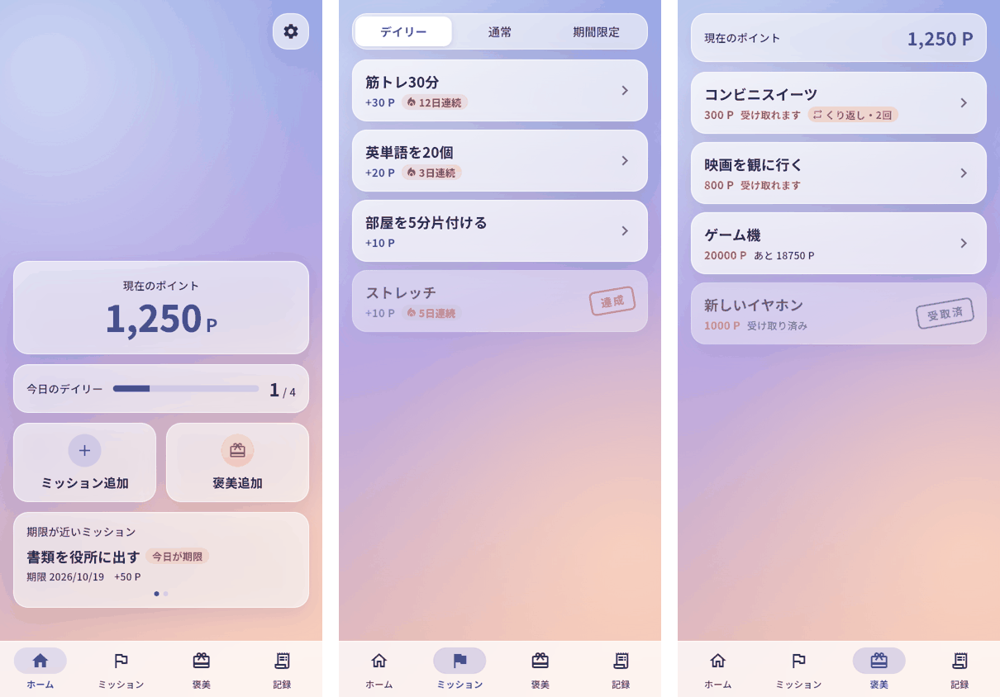
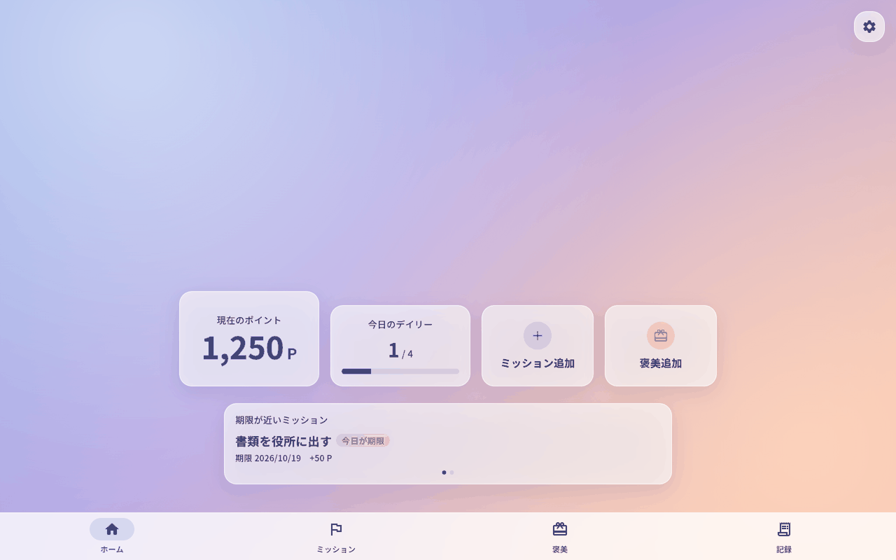

# Mission Reward

決めたミッションをこなしてポイントを貯め、そのポイントで自分にご褒美をあげるための、個人用アプリです。
スマホではホーム画面に追加してアプリとして、PCではブラウザかWindows版で使えます。



## このアプリの考え方
- 登録したミッションは、あとから内容やポイントを変えたり、削除したりできません。
  決めた時点の気持ちに重みを持たせるためです。その代わり、登録前に内容を確認する画面があります。
- 達成とご褒美の受け取りは、取り消しできない操作として二段階で確認します。
- 日付の切り替わりは朝5時です。夜更かしした分は前日として数えます。

## できること
- ミッション：デイリー（毎朝リセット）／通常／期間限定（期限つき）
- デイリーの連続達成日数の表示
- ご褒美：1回限り／くり返し受け取れるもの
- ポイントの履歴（日ごとにまとめて表示）
- 好きな画像を壁紙に設定
- データのバックアップと復元

## 使い方
https://neylilja-cmd.github.io/mission/ を開きます。
- iPhone：Safariで開き、共有ボタン →「ホーム画面に追加」
- Android：Chromeで開き、メニュー →「アプリをインストール」
- PC：Chromeなどで開き、アドレスバー右のインストールボタン

一度開けば、電波がない場所でも使えます。



## データについて
- データはすべて使っている端末（ブラウザ）の中だけに保存され、外部には送信されません。
- スマホとPCのデータは別々です。
- ブラウザのデータを消すとアプリのデータも消えるので、ときどき「設定 → バックアップ」で書き出しておくのがおすすめです。

## 開発
Flutterで作っています。

```bash
flutter pub get
flutter test
flutter run -d chrome     # ブラウザで実行
flutter run -d windows    # Windows版を実行
```

main に変更を入れると、GitHub Actions がテストとビルドを行い、GitHub Pages に公開します。
